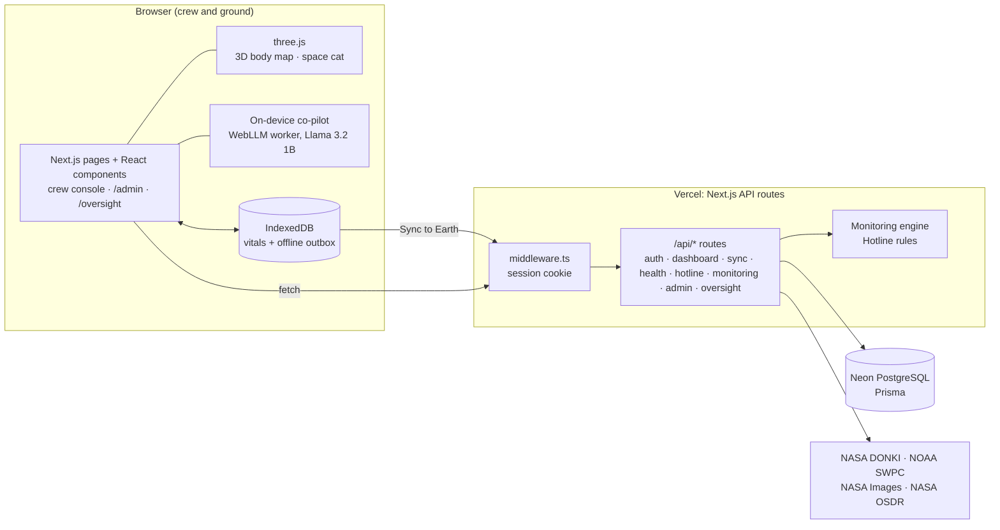
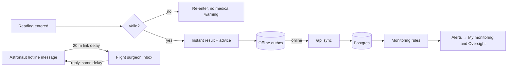
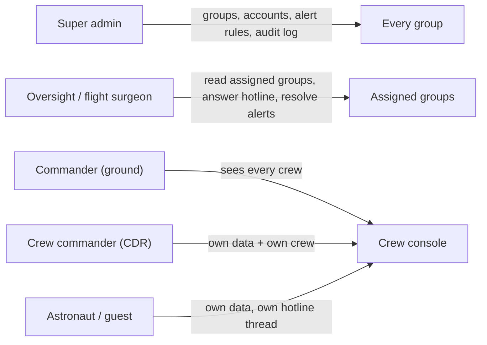
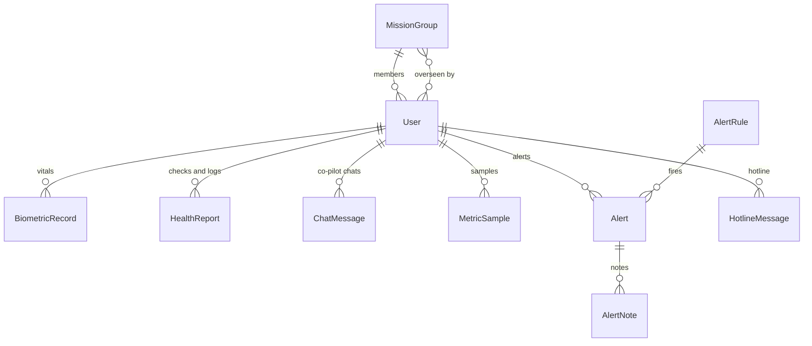
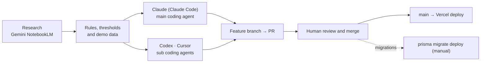

# AstroMed · Astronaut Health Monitoring Console

**Live demo:** https://astro-med-ashy.vercel.app

A NASA Space Apps Challenge prototype: a self-assessment health console for astronauts on long missions. Our scenario is the MTV-1 Mars transit, 20 light-minutes from Earth.

Crew members measure their own health and see colour-coded results with plain-language explanations. When something is wrong, an on-device AI co-pilot tells them what to do, and it keeps working when the link to Earth is down.

On the ground, a **super admin** sets up mission groups and crew accounts, and **mission oversight** (flight surgeons and mission control) follows every astronaut in their assigned groups: vitals, health logs and AI co-pilot conversations.

> Concept prototype for a hackathon. Not an official NASA system and not medical advice.

## What's new (2026-11-15)

- **Hotline to Earth:** a direct line from each astronaut to the Earth medical team, with Routine / Urgent / Emergency levels, the 20 m link delay and an offline queue. Flight surgeons answer from `/oversight`.
- **Sleep and fluid add up:** a 5 h sleep entry plus a 2 h nap counts as 7 h and resolves the short-sleep alert ("Today's total 7.0 h · back to safe"). Fluid works the same way. The Sleep and Hydration tabs offer **Add to today's total** (default) or **Replace today's value**, and the server keeps the running total, so it works across devices.
- **Crew grid without guests:** demo sign-ins with an unknown email (callsign GUEST, e.g. "Admin" or "Flight Surgeon") no longer appear as crew cards for the commander or ground control. A guest still sees their own dashboard.
- **Hotline offline notice:** a hotline message written with no link now says **Queued** (it goes out first when the link returns, then reaches Earth after the delay) instead of "Sent". An emergency also tells the crew to follow the emergency checklist now.
- **Daily check:** every reading is a clickable tab. Save a single reading (e.g. water) or re-test one: the newest value updates your status and monitoring, and the alert log notes it ("Re-test 118/76 mmHg · back to safe").
- **Input checks:** a swapped blood pressure (e.g. 80/120) asks you to re-enter instead of giving a medical warning. Super admins can't save impossible blood pressure alert rules, and monitoring ignores swapped readings.
- **3D body map:** a realistic body made from the MakeHuman CC0 base mesh, matched to the account's sex, with injuries reported by tapping the 3D body. Browsers without WebGL get a list instead, and **Report injury** always works.
- **Space cat:** a 3D astronaut cat companion you feed with mission points. It speaks your voice reminders.
- **Clearer status:** an irregular heart rhythm is always a warning; one shared colour per status level; the header says it is based on vitals only; sync shows Queued / Sent / Confirmed by Earth; the sensor-dropout demo shows the last valid reading and its age.
- **Look and feel:** sidebar navigation, a new light theme (white cards, sunflower-yellow accent) beside the dark theme, and a compact co-pilot button on phones.
- **Monitoring and co-pilot:** Daily Check readings feed monitoring alerts, a hydration alert workflow, and an improved onboard co-pilot with personalised grounding.

## How it meets the challenge

| Challenge asks for                                                            | AstroMed                                                                                                                                                     |
| ----------------------------------------------------------------------------- | ------------------------------------------------------------------------------------------------------------------------------------------------------------ |
| Astronauts assess their own health                                            | Each crew member signs in to their own console, takes a guided **Daily self-check**, and sees their own vitals                                               |
| Indicators: blood pressure, heart rate, blood sugar, temperature, sleep, mood | All six, plus HRV, SpO₂, radiation dose, cabin CO₂, exercise and a reaction-time test                                                                        |
| Guidance on treatment and improvement                                         | Advice on every reading, plus an **AI co-pilot** with ISS-style protocols, crew baselines and the medicine kit                                               |
| When to involve crew or flight surgeons                                       | Daily Check shows follow-up guidance on flagged readings, and **Crew oversight** shows synced monitoring alerts for assigned groups            |
| Managing many crews                                                           | A **Super admin console** creates mission groups and astronaut accounts, and decides which groups each oversight user can see                                |
| NASA HRP's five hazards                                                       | **RIDGE strip** (Radiation, Isolation, Distance, Gravity, hostile Environment), linked to the body systems each one affects                                  |
| Clickable human figure                                                        | **Body map**: brain, eyes, heart, lungs, blood, bones & muscles and reproductive health, each with status, what it does, how space affects it and what to do |
| Prompts and routine                                                           | Morning self-check banner, exercise and sleep voice reminders                                                                                                |
| Gamification                                                                  | **Health missions** with points, streaks and mission patches                                                                                                 |
| Charts over time                                                              | Live ECG, 24 h HRV trend, exercise and sleep progress                                                                                                        |
| Colour coding                                                                 | Green / amber / red everywhere, following NASA-STD-3001 caution & warning colours                                                                            |
| Simple instructions                                                           | Each measurement has numbered "how to measure" steps and a "why this matters in space" note                                                                  |

## Features

### Daily self-check

Six guided steps, each also a **tab you can open directly**:

- **Blood pressure** (mmHg)
- **Blood sugar** (mg/dL, fasting or after a meal)
- **Body temperature** (°C)
- **Mood** (5 faces)
- **Sleep** (pre-filled from the sleep log)
- **Hydration** (fluid in the last 24 hours in mL and the most recent urine colour on an 8-shade chart)

Results turn green, amber or red as they're typed, with follow-up guidance.

- **Next** needs a valid value; **Skip** leaves the step out and records it as not measured.
- A reading that can't be right (e.g. blood pressure 80/120 with the numbers swapped) asks you to re-enter instead of giving a medical warning.
- **Save just this reading** logs one tab on its own, with its own time (e.g. water after a drink). It doesn't count as the full daily check.
- **Sleep and fluid are daily totals:** once a value is saved today, the Sleep and Hydration tabs ask whether to **Add to today's total** (default, e.g. a nap or another drink) or **Replace today's value**. A live preview shows the sum ("Today's total: 5.0 + 2 = 7.0 h"), and reaching the safe level resolves the alert.
- **Re-tests:** for blood pressure, sugar, temperature and mood, the newest reading replaces the older one in today's status (a high blood pressure re-tested as normal shows normal), syncs to monitoring, and clears the alert with a note naming the re-test.
- An unfinished check resumes where you left it (kept on the device for 12 hours), and the results page confirms it was saved.
 Open **My monitoring** from flagged results to follow synced alerts. On a **Low fluid intake** alert, use **Log water** to add 250 mL, 500 mL or a custom amount after the last check. A fresh 24-hour reading replaces the prior total.

### Body map + five hazards

- A rotatable **3D body** built from the MakeHuman base mesh (CC0), baked into `public/models/body.bin` by `scripts/bake-body-model.py`. The male or female build follows the astronaut's account.
- A clickable status point per body system.
- Each system shows its readings, what it does, how spaceflight affects it, and what to do now.
- Injury and period tracking are built in. **Report injury** places a marker by tapping the 3D body. Without WebGL, **Report injury** opens the report form directly and you choose the body area from a list.
- The **RIDGE** strip shows a live status for each hazard. Picking one highlights the body systems it affects.

### My vitals / Crew vitals

- Each astronaut sees **only their own** vitals (tab **My vitals**). The crew commander (callsign CDR) sees their whole crew, and ground control sees every crew (tab **Crew vitals**). This is enforced on the server: `/api/dashboard` only returns the records the signed-in user may see.
- Big heart rate, SpO₂ and HRV tiles.
- A realistic Lead II ECG: PQRST beats, HRV-driven rhythm and a monitor sweep. It turns irregular in the arrhythmia scenario.
- 24 h HRV trend, plus per-crew baselines (and a crew overview for the commander and ground control). Demo guest accounts (callsign GUEST) are left out of the crew overview.
- An irregular rhythm always shows **WARNING**, on the card, in the header and in the assessment. The header pill is based on vitals only; the Medical assessment says what it is based on.
- When the wearable stops sending, the tiles freeze on the **last valid reading** with its age (e.g. "last valid reading · 2 min ago"), and the ECG shows no signal. Nothing is invented.

### Hotline to Earth

- A red **Hotline to Earth** button and a **Hotline** sidebar item (with an unread badge) for astronauts.
- Quick messages (Medical emergency, Need a consult, Medication question) and **Routine / Urgent / Emergency** levels. An emergency asks for confirmation first, and the latest vitals can be attached.
- Messages arrive after the Earth link delay (20 m 04 s; a demo switch shortens it to 20 s; instant in ground mode). The crew sees a countdown, then Delivered, Seen, Acknowledged and Resolved.
- Written offline, a message waits in the sync queue and goes out first when the link returns. The notice says **Queued** (not "Sent") and the message shows "Waiting to send" until it leaves.
- **Earth side** (`/oversight`): a banner and chime for urgent messages, conversations sorted by urgency, the thread with vitals, replies (sent back with the same delay), **Acknowledge** and **Mark resolved**.
- Astronauts only reach their own thread; oversight only reaches astronauts in groups assigned to them.

### Space cat (Crew Morale)

- An original 3D astronaut cat (three.js, no external models), with a flat fallback without WebGL. Tap, rub or drag it; it waves, winks, purrs and wags its tail.
- Feed it with mission points (30 per meal). It gets hungry over time and grows through Slim, Plump and Chonky.
- When **Voice reminder → Auto** is on, the cat floats on every page and speaks the reminders. If the browser blocks sound, it shows "Tap to turn sound on".
- **Talk to me** records you and plays it back in a squeaky voice. Reminder speech stops while you talk.

### Health missions

- Four daily core missions: self-check, exercise plan, 7 h sleep and the reaction-time test. Reviewing the body map is a bonus.
- Points, a 🔥 streak and eight mission patches.
- Patches reward habits, never health values.

### Habitat & routine

- Cabin CO₂ and radiation dose against flight-rule limits, with a scrubber/shielding boost.
- Exercise log for ARED, treadmill and cycle against an ISS-style plan.
- Sleep log and spoken reminders.

### Cognitive test

- **Beacon Lock**: a reaction-time (PVT) game that measures alertness and lapses.

### AI co-pilot

See [the co-pilot guide](docs/COPILOT.md) for prompt instructions, NASA sources, and how to run the benchmark.

- Runs **Llama 3.2 1B** fully in the browser with [WebLLM](https://github.com/mlc-ai/web-llm), so answers don't depend on the link to Earth.
- Every question and reply is saved for mission oversight (queued offline, sent when the link is back). The chat panel tells the crew so.
- It gets the crew's vitals, baselines, protocols, medicine kit, today's self-check and habitat data.
- **Basic mode:** without WebGPU, or when the model can't load, it falls back to built-in triage rules with no errors.
- On GPUs without `shader-f16` it uses f32 builds, and it tries a smaller model before giving up.

### Offline first

- Vitals are saved to IndexedDB (Dexie) and synced to Postgres with **Sync to Earth** when the link is back. The queue shows each record as **Queued**, **Sent** (no reply yet) or **Confirmed by Earth**.
- Co-pilot chats, hotline messages, self-checks, exercise and sleep, injuries and period logs go through the same kind of IndexedDB outbox. An item leaves the queue only when the server confirms it.

### Mission groups and roles

| Role                                             | Lands on     | Can do                                                                                                                                                                        |
| ------------------------------------------------ | ------------ | ----------------------------------------------------------------------------------------------------------------------------------------------------------------------------- |
| **Super admin**                                  | `/admin`     | Create, edit and delete mission groups; create astronaut and oversight accounts; move astronauts between groups; assign groups to oversight; read every group in `/oversight` |
| **Oversight** (flight surgeon / mission control) | `/oversight` | Read the astronauts in their assigned groups only, including their AI conversations; answer their hotline messages                                                           |
| **Commander** (ground control)                   | Console      | Sees every crew on the console                                                                                                                                                |
| **Astronaut, crew commander** (callsign `CDR`)   | Console      | Their own console plus every member of their own crew                                                                                                                         |
| **Astronaut**                                    | Console      | Only their own health console and data; belongs to one mission group                                                                                                          |

Every admin and oversight API checks the role on the server, from the database. An oversight user asking for a group or astronaut outside their assignment gets a 404.

### Super admin console (`/admin`)

- **Mission groups:** name, code (shown as the crew id, e.g. `MTV-1`), mission / destination and description. A group with members can't be deleted.
- **Astronauts:** create an account inside a group with name, callsign, email and a temporary password (a **Generate** button makes one; it's stored hashed with bcrypt). Move astronauts between groups from the list.
- **CSV import:** paste `name, email, callsign` lines to create many astronauts in one group. Each gets its own temporary password, shown once.
- **Oversight accounts:** create flight-surgeon or mission-control accounts and tick the groups each one may read.
- **All users:** search by name, email or callsign and filter by role, group and status. Per account:
  - **Edit:** name, callsign, role, and group for astronauts. Role changes are confirmed first.
  - **Reset password:** sets a new temporary password, shown once.
  - **Disable / Enable:** a disabled account can't sign in and loses any open session at once. Its records and AI chats are kept.
  - **Delete:** permanent, and removes the account's vitals, health logs and chats. You confirm by typing the account's email.
  - You can't disable, delete or change the role of your own account, and the console always keeps at least one active super admin.
- **Audit log:** who did what, to which group or account, and when, for every admin action.

### Crew oversight dashboard (`/oversight`)

- Pick a group to see every astronaut at a glance: latest vitals in green / amber / red, sleep, exercise, self-check result, open injuries, cycle status, AI chat count and the top alerts.
- Click an astronaut for their full record:
  - **Status & alerts**
  - **Vitals history** (newest 200 readings)
  - **Health logs:** every self-check, exercise and sleep day, body-map injury report (with photos) and period day
  - **AI conversations:** the full co-pilot transcript in time order, searchable, with each reply marked on-device AI or basic mode

### Health monitoring

Full detail, thresholds and NASA sources: **[docs/METRICS.md](docs/METRICS.md)**.

- **Metrics:** all Daily Check readings, exercise, pulse trend and radiation dose. Blood pressure shows both numbers, and blood sugar keeps fasting context. Each metric has a definition, expected cadence and rationale under **Why we monitor this**.
- **Dashboard:** 7 / 14 / 30-day daily charts per metric with the amber and red lines, a **missing-data badge** per metric (On time / Late / Missing / No data yet, from the expected cadence) and a **trend summary** with % change against the previous period. Oversight sees it per astronaut (**Monitoring** tab); crew see their own under **My monitoring**.
- **Alerts:** super admins can edit thresholds, windows and enabled status in **Alert rules**. Daily Check rules use the latest applicable value, including the latest daily fluid total. Alerts go **open → acknowledged → resolved** with a note thread. Crew can note and acknowledge their own alerts, and oversight can also resolve alerts. The app resolves an alert when a follow-up value clears its rule, and the note names the reading (e.g. a Daily Check re-test). Blood pressure rules must stay realistic: the systolic limits above the diastolic ones.
- **Synthetic crew:** `npm run db:synthetic` seeds group **SIM-1** with six SYNTHETIC astronauts (normal, missing data, sleep debt, rising heart rate, dehydration, solar particle event), 14–30 days each, seedable.

### Demo scenarios

The header's **Demo** dropdown switches between:

- Nominal
- Arrhythmia · 20m latency
- EV1 voice stress
- ppCO₂ + PVT slowdown
- Solar particle event
- Missing data · sensor dropout (the wearable stops sending: the console shows the last valid reading with its age, and oversight sees the gap)

## Getting started

Requirements: Node 20+, and a PostgreSQL database such as [Neon](https://neon.tech) or local Docker.

```bash
cp .env.example .env      # then fill in DATABASE_URL and SESSION_SECRET
npm install
npx prisma migrate deploy # create / update the tables
npm run db:seed           # demo crew, mission groups, admin and oversight accounts
npm run db:synthetic      # optional: SYNTHETIC test crew SIM-1 (30 days, seed 1)
npm run dev               # http://localhost:3000
```

Tests:

```bash
npm test                  # Vitest unit tests (136): alert rules, trends, validation, hotline, sync, space cat
npm run test:e2e          # Playwright UI tests (re-seeds SIM-1; uses installed Edge, PW_CHANNEL=chromium to change)
```

The e2e tests write to the database your dev server uses. Don't run them against the shared demo database. They sign up throwaway guest accounts and delete them again at the end of each run.

A database that was created earlier with `db:push` has no migration history yet. Baseline it once with `npx prisma migrate resolve --applied 0_init`, then run `npx prisma migrate deploy`.

For the full AI co-pilot, use Chrome or Edge 113+ on a computer with a WebGPU-capable GPU. Other browsers still work in basic mode.

### Environment variables

| Name                                             | Required | Purpose                                                                                                                                                                                                                                                                                 |
| ------------------------------------------------ | -------- | --------------------------------------------------------------------------------------------------------------------------------------------------------------------------------------------------------------------------------------------------------------------------------------- |
| `DATABASE_URL`                                   | yes      | PostgreSQL connection string                                                                                                                                                                                                                                                            |
| `SESSION_SECRET`                                 | yes      | Long random string used to sign the login cookie                                                                                                                                                                                                                                        |
| `DEMO_MODE`                                      | no       | `true` lets any email/password sign in and auto-creates an astronaut profile. Super admin and oversight accounts always need their real password, and demo mode never creates them. Defaults to on outside production and off in production. **Set `false` for any public deployment.** |
| `SEED_ADMIN_PASSWORD`, `SEED_OVERSIGHT_PASSWORD` | no       | Passwords the seed gives the super admin and oversight accounts. **Set them for any deployment other people can reach**; the defaults are in `prisma/seed.ts`.                                                                                                                          |
| `NEXT_PUBLIC_WEBLLM_MODEL`                       | no       | Pin a WebLLM model, e.g. `SmolLM2-360M-Instruct-q4f16_1-MLC` for a much smaller download                                                                                                                                                                                                |

### Demo accounts

**Live demo (https://astro-med-ashy.vercel.app):** every account below uses the password **`password`**. This is a hackathon demo setting: change these passwords before any real use.

**Fresh local seed:** crew get **`aahms2025`**, and admin/oversight get `SEED_ADMIN_PASSWORD` / `SEED_OVERSIGHT_PASSWORD` (or the defaults in `prisma/seed.ts`). In demo mode, any password works for crew.

| Email                                                                                             | Role                                                                                                               |
| ------------------------------------------------------------------------------------------------- | ------------------------------------------------------------------------------------------------------------------ |
| `admin@aahms.demo`                                                                                | Super admin: `/admin` creates mission groups, astronaut and oversight accounts                                     |
| `surgeon@aahms.demo`                                                                              | Oversight (flight surgeon): `/oversight` reads MTV-1 (and SIM-1 after `db:synthetic`), including AI co-pilot chats |
| `sim-normal@aahms.demo` … `sim-spe@aahms.demo`                                                    | SYNTHETIC test astronauts in SIM-1, one per profile                                                                |
| `ground@aahms.demo`                                                                               | Commander (ground control), sees every crew                                                                        |
| `vance@aahms.demo`                                                                                | Crew commander CDR (MTV-1), sees the whole MTV-1 crew                                                              |
| `john@aahms.demo`                                                                                 | Astronaut EV1 (MTV-1), sees only himself                                                                           |
| `cho@aahms.demo`, `silva@aahms.demo`, `reyes@aahms.demo`, `park@aahms.demo`, `okonkwo@aahms.demo` | Other crew                                                                                                         |

## Five-minute demo script

1. Sign in as `john@aahms.demo`.
2. **My vitals:** follow the "Morning self-check due" banner and do the check. Try BP `118/102` to see a red diastolic result, then open **My monitoring** to see the alert.
3. **Body map:** click the regions, then pick **G** (Gravity) in the hazards strip to see which systems it affects.
4. **Missions:** use the **Go** buttons to finish the exercise plan (log 46 min), sleep (22:30 → 06:00) and **Beacon Lock**. The ring hits 4/4 and the patches unlock.
5. Switch **Demo → Solar particle event** and watch radiation, the body map and the assessment react.
6. **Ask the co-pilot** a question, e.g. "I feel dizzy, what should I do?"
7. **Offline:** in DevTools set Network → Offline, record vitals, go back online, then click **Sync to Earth**.
8. **Ground side:** sign out and sign in as `admin@aahms.demo`. Create a mission group and an astronaut in it, and tick the group for the flight surgeon on **Oversight accounts**.
9. Sign in as that astronaut and ask the co-pilot something, then sign in as `surgeon@aahms.demo`. Open the group, click the astronaut and check **AI conversations** and **Health logs**. MTV-2 isn't listed, because the surgeon isn't assigned to it.
10. **Monitoring:** still as the surgeon, open **SIM-1**. Sim Dropout shows missing data; open Sim Rising HR's **Monitoring** tab for the trend, then **Alerts** on Sim Dehydrated: open **Why this alerted**, add a note and **Acknowledge**, then **Resolve**. As `admin@aahms.demo`, change a threshold in **Alert rules** and see it in the audit log.

## Deployment (Vercel + Neon)

The live demo runs on **Vercel** with a **Neon** PostgreSQL database.

1. Create a Neon database and copy its connection string.
2. Locally, put it in `.env` as `DATABASE_URL`, then run `npx prisma migrate deploy`, `npm run db:seed` and (optionally) `npm run db:synthetic`. `tsx` doesn't read `.env` by itself, so export the variables in your shell first.
3. In Vercel, import the GitHub repo (Next.js is detected) and set **Environment Variables**: `DATABASE_URL` (the Neon URL), `SESSION_SECRET` (a new random string, e.g. `node -e "console.log(require('crypto').randomBytes(32).toString('hex'))"`) and `DEMO_MODE=false`.
4. Deploy. Every push to `main` redeploys.

Never commit `.env` or the database URL: secrets live only in `.env` and in Vercel's settings.

## Changes in AstroMed

- Renamed the app to **AstroMed** (browser title, login page, headers, logo).
- **Crew privacy:** astronauts see only their own dashboard; the crew commander (CDR) sees their crew; ground control sees every crew. Enforced on the server.
- Removed the **Space / Earth** buttons from the console header (the console always runs in space mode).
- **Sidebar navigation** grouped into Clinical Telemetry, Habitat & Protocols, Operations & Sync and Crew Morale, with **My vitals** as the main screen.
- **Light and dark themes:** a soft white-and-yellow light theme and a black-and-lime dark theme (toggle in the header).
- Deployed to Vercel with a Neon database (see above).

## Architecture





**Roles**



**Data model**



More detail (folders, security, offline sync, the hotline sequence with the link delay): **[docs/ARCHITECTURE.md](docs/ARCHITECTURE.md)**.

## How we build it



- **Research:** the team used **Gemini NotebookLM** to research space medicine and astronaut health. Its findings and data informed the Daily Check ranges, monitoring rules, co-pilot protocols, flight-rule limits and demo data (see [docs/WORKFLOW.md](docs/WORKFLOW.md) for where each lives in the code).
- **Coding:** **Claude (Claude Code)** is the main coding agent. **Codex** and **Cursor** are sub coding agents. Every change goes through a pull request that a team member reviews and merges.
- **Shipping:** merges to `main` deploy to Vercel automatically. Database migrations are applied by hand with `prisma migrate deploy`.

## Documentation

| Document | What's in it |
| --- | --- |
| [docs/ARCHITECTURE.md](docs/ARCHITECTURE.md) | System diagram, folders, roles and access, data model, data flows, hotline sequence, offline parts |
| [docs/FEATURES.md](docs/FEATURES.md) | Every feature: what it does, where the code is, how to try it |
| [docs/API.md](docs/API.md) | Every API route with methods, roles and purpose |
| [docs/WORKFLOW.md](docs/WORKFLOW.md) | Research → build → review → deploy, AI tooling, branches, migrations, testing |
| [docs/DEPLOYMENT.md](docs/DEPLOYMENT.md) | Environment variables (names), Vercel, Neon, migration and seeding cautions |
| [docs/METRICS.md](docs/METRICS.md) | Monitoring metrics, thresholds and NASA sources |
| [docs/COPILOT.md](docs/COPILOT.md) | Co-pilot prompt, knowledge base and benchmark |

## Tech stack

- **Next.js 16** (App Router, built with webpack), **React 19**, TypeScript, **Tailwind CSS v4**
- **Prisma 6** + **PostgreSQL** (Neon) with migrations, including an admin audit log; JWT session cookie (`jose`); role checks against the database for admin and oversight APIs
- **Dexie** (IndexedDB) store-and-forward queue
- **@mlc-ai/web-llm** in a Web Worker: idle preload, warmup, streaming replies, cached weights

## Project structure

```
app/                 Next.js routes: login, crew console, /admin, /oversight, and API
                     (auth, dashboard, biometrics sync, chat/messages, health/reports,
                     admin/groups + admin/users + admin/alert-rules, oversight/groups +
                     oversight/members (+ monitoring), monitoring/me, alerts/[id])
components/          UI: SuperAdminDashboard (crew console), BodyMap, DailySelfCheck, HealthMissions,
                     VitalsMonitor + EcgMonitor, ExerciseSleep, PVTTest, OfflineAICopilot, …
components/staff/    AdminConsole, OversightConsole, StaffHeader, ConfirmDialog (ground consoles)
components/hotline/  CrewHotline, EarthHotline (crew ↔ Earth hotline)
components/spacecat/ SpaceCatView, FloatingCat, TalkBack, cat3d/ (3D astronaut cat)
components/monitoring/ MonitoringPanel, MetricChart, AlertsPanel, MonitoringView
lib/                 Logic: risk rules, selfCheck, bodyMap (+ hazards), missions, routineLog,
                     injuries, periods, copilot knowledge/fallback, webllm engine, Dexie db,
                     outbox (chat + health log sync), authz (role checks), healthSummary
lib/hotline/         hotline rules (validation, permissions, delivery) and server helpers
lib/monitoring/      catalog (metrics, rules, NASA sources), engine (series, missing data,
                     trends, rules, alert lifecycle), synthetic generator, server helpers
scripts/             bake-body-model.py (3D body mesh), metrics-doc, copilot benchmark
prisma/              Schema, migrations (incl. user sex and hotline), seed data (groups MTV-1 / MTV-2, admin, oversight)
                     and synthetic.ts (SYNTHETIC crew SIM-1)
tests/               unit/ (Vitest) and e2e/ (Playwright)
docs/METRICS.md      Metric definitions, thresholds and citations (generated from the catalog)
```

## Notes and limits

- Thresholds and advice are demo guidance based on common clinical cut-offs and NASA Human Research Program summaries. They are not medical advice.
- Monitoring alerts are a simulation: rules are evaluated when a crew member's monitoring is viewed, not by a background job, and nothing is paged or sent anywhere.
- Missions and the PVT result stay in the browser. Vitals, self-checks, exercise and sleep, injuries and period logs sync to the database through the offline queue so mission oversight can read them.
- **Privacy:** every AI co-pilot message (the astronaut's questions and the replies) is stored on the server and readable by the oversight users assigned to that astronaut's group and by the super admin. The co-pilot shows the crew a note saying so.
- Hotline delivery is checked by polling every few seconds; nothing is paged or sent outside the app.
- **Neon cold starts:** an idle Neon database can take 6–9 s to wake, longer than Prisma's default 5 s connection timeout. The first request after a quiet spell can then fail (e.g. "Hotline server unavailable"). Adding `connect_timeout=15` to `DATABASE_URL` avoids this.
- The first co-pilot load downloads about 0.7 GB of model weights once. After that they're cached in the browser.
