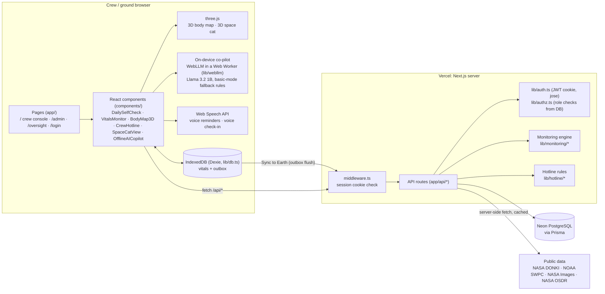
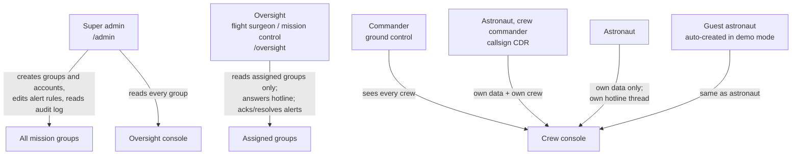
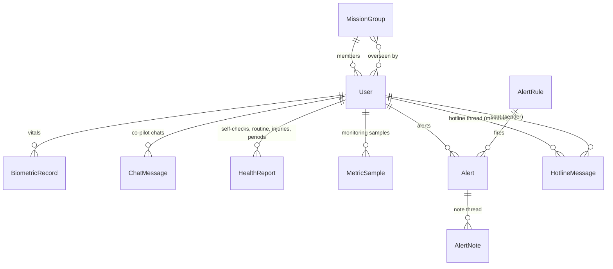
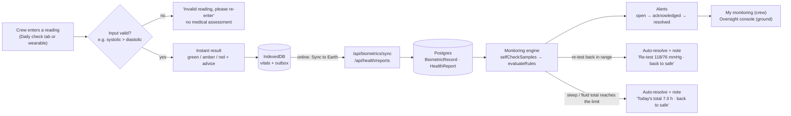
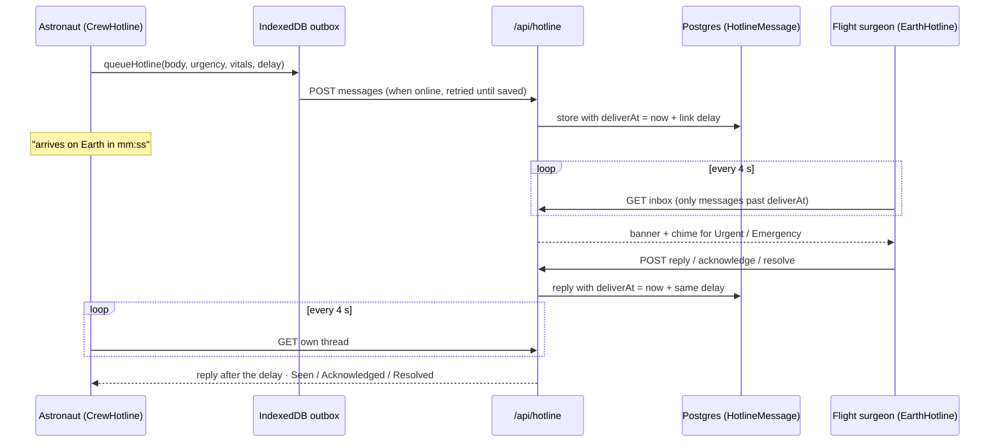

# Architecture

AstroMed is one Next.js 16 app (App Router) deployed on Vercel, with a Neon PostgreSQL database behind Prisma. Almost everything the crew sees runs in the browser and keeps working offline. The server stores what is synced and serves the ground consoles.

## System overview

## Folders

| Folder | What lives there |
| --- | --- |
| `app/` | Routes: `page.tsx` (crew console), `admin/`, `oversight/`, `login/`, and `api/` (see [API.md](API.md)) |
| `components/` | Crew console UI: `SuperAdminDashboard` (console shell), `ui/SideNav`, `MissionHeader`, `DailySelfCheck`, `VitalsMonitor` + `EcgMonitor`, `BodyMap` + `BodyMap3D`, `InjuryPanel`, `ExerciseSleep`, `HealthMissions`, `PVTTest`, `CabinEnvironment`, `LabPanel`, `StoreForwardQueue`, `OfflineAICopilot`, `SyncContext` |
| `components/hotline/` | `CrewHotline` (crew side), `EarthHotline` (oversight side), unread badge hook |
| `components/spacecat/` | `SpaceCatView`, `FloatingCat`, `TalkBack`, `cat3d/` (procedural three.js cat) |
| `components/staff/` | Ground consoles: `AdminConsole`, `OversightConsole` |
| `components/monitoring/` | Charts, alerts panel, monitoring view |
| `lib/` | Logic: `risk`, `selfCheck`, `selfCheckThresholds`, `bodyMap`, `injuries`, `missions`, `labs`, `osdr`, `spaceWeather`, `voiceReminder`, `spaceCat`, `statusColors`, `outbox`, `db`, `auth`, `authz` |
| `lib/monitoring/` | `catalog` (metrics, rules, NASA sources), `engine` (series, missing data, trends, rule evaluation, alert lifecycle), `server`, `selfCheckSamples` |
| `lib/hotline/` | `rules` (validation, permissions, delivery timing, inbox ordering), `server` |
| `lib/webllm/` | `engine`, `worker`, `reply` for the on-device model |
| `lib/data/` | Bundled demo data: Inspiration4 lab values, OSDR study cache, space-weather snapshot |
| `prisma/` | `schema.prisma`, `migrations/`, `seed.ts`, `synthetic.ts` |
| `scripts/` | `bake-body-model.py` (3D body mesh), `metrics-doc.ts`, `copilot-benchmark.ts` |
| `tests/` | `unit/` (Vitest), `e2e/` (Playwright) |

## Roles and access

- The session is a signed JWT cookie (`lib/auth.ts`). `middleware.ts` blocks unauthenticated requests except the login and public data routes.
- Admin and oversight APIs read the role from the database on every request (`lib/authz.ts`), so a demoted or disabled account loses access at once.
- Oversight users asking for a group or astronaut outside their assignment get **404**, so ids can't be probed.
- Hotline: astronauts reach only their own thread; Earth staff reach only astronauts in groups they can read (`lib/hotline/rules.ts`).
- Demo mode (`DEMO_MODE`) lets any email sign in as a guest astronaut (callsign GUEST, crew MTV-1). Super admin and oversight accounts always need their real password. Guests see their own dashboard but never appear in anyone's crew overview (`app/api/dashboard/route.ts`).

## Data model

Standalone tables: `AdminAuditLog` (who did what), `NasaStudy` (cached OSDR studies). Deleting a user cascades to everything they own. Enums: `Role`, `ChatRole`, `ChatMode`, `HealthReportKind`, `AlertStatus`, `HotlineUrgency`.

## Daily check and vitals → monitoring → oversight

- Each queued item leaves the outbox only when the server confirms it. The Queue page shows **Queued → Sent → Confirmed by Earth**.
- Swapped blood pressure pairs never become monitoring samples (`lib/monitoring/selfCheckSamples.ts`).
- Sleep and fluid entries can be added to today's value. The server keeps the running daily total (`sleepAddedHours` / `fluidAddedMl`), and the latest-reading rule sees that total. Other readings are re-tests: the newest one wins.
- Rules are evaluated when monitoring is viewed, not by a background job.
- Alert thresholds live in `lib/selfCheckThresholds.ts` and `lib/monitoring/catalog.ts`. Super admins can edit them in **Alert rules**, and blood pressure limits are validated.

## Hotline with the communications delay

- The space link delay is 20 m 04 s. A demo switch shortens it to 20 s, and ground mode is instant.
- Messages are validated (1000-character limit, known urgency, whitelisted vitals) and rate-limited (8 per minute for crew, 20 per minute for Earth).
- A device-generated `clientId` makes offline re-sends idempotent.

## Offline and on-device parts

- **Vitals and logs:** written to IndexedDB first (`lib/db.ts`, `lib/outbox.ts`), then flushed to the server. Hotline messages go first in the flush.
- **Co-pilot:** WebLLM runs the model in a Web Worker, so answers don't depend on the link. Without WebGPU it uses the built-in triage rules (`lib/copilotFallback.ts`). See [COPILOT.md](COPILOT.md).
- **Voice:** reminders use speech synthesis (local voices work offline). Voice typing uses the browser's online speech service, and the UI says so before use.
- **3D:** the body map and the space cat render with three.js. If WebGL is missing or the context is lost, both fall back (a body-area list and a flat cat).

## External data

Fetched server-side and cached, with bundled snapshots as fallback: NOAA SWPC and NASA DONKI (space weather), NASA Image Library (login and backgrounds), NASA OSDR (research studies and Inspiration4 lab values in `lib/data/`).
