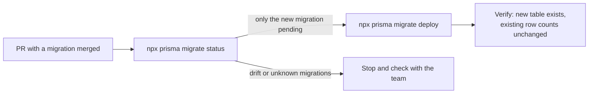

# Deployment

The live demo runs on **Vercel** with a **Neon** PostgreSQL database.

## Environment variables (names only)

| Name | Required | Purpose |
| --- | --- | --- |
| `DATABASE_URL` | yes | PostgreSQL connection string |
| `SESSION_SECRET` | yes | Long random string that signs the session cookie |
| `DEMO_MODE` | no | `true` lets any email sign in as a guest astronaut. Set `false` for a real public deployment |
| `SEED_ADMIN_PASSWORD`, `SEED_OVERSIGHT_PASSWORD` | no | Passwords the seed gives the super admin and oversight accounts |
| `NEXT_PUBLIC_WEBLLM_MODEL` | no | Pin a different WebLLM model |

Secrets live only in `.env` (git-ignored) and in Vercel's settings. Never commit them.

## Vercel

1. Import the GitHub repo in Vercel (Next.js is detected; the build is `next build --webpack`, and `postinstall` runs `prisma generate`).
2. Set the environment variables above.
3. Every merge to `main` deploys automatically.

## Database (Neon)



- The build does **not** apply migrations. Apply them by hand with `npx prisma migrate deploy` after the PR is merged.
- First setup of an empty database: `npx prisma migrate deploy`, then `npm run db:seed`, and optionally `npm run db:synthetic` (SYNTHETIC crew SIM-1).
- **Cautions for the shared database:** don't run `migrate dev`, `migrate reset` or `db push`, don't reseed it, and don't run the e2e tests against it (they write test data).
- `tsx` scripts don't read `.env` by themselves, so export the variables in your shell first.
- **Cold starts:** an idle Neon database can take 6–9 s to wake, longer than Prisma's default 5 s connection timeout, so the first request after a quiet spell can fail (e.g. "Hotline server unavailable", or a demo sign-in that falls back to an offline identity). Add `connect_timeout=15` to `DATABASE_URL`, locally and in Vercel.

## Local development

```bash
cp .env.example .env      # fill in DATABASE_URL and SESSION_SECRET
npm install
npx prisma migrate deploy
npm run db:seed
npm run dev               # http://localhost:3000
```
