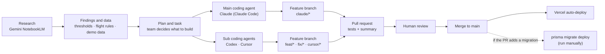

# How we build AstroMed

## Overview

## 1. Research: Gemini NotebookLM

The team used **Gemini NotebookLM** to research space medicine and astronaut health. Its findings and data informed what the app checks and the guidance it gives. In the code, that research lives in:

| Topic | Where it is used |
| --- | --- |
| Daily Check normal ranges and alert limits | `lib/selfCheck.ts`, `lib/selfCheckThresholds.ts` |
| Monitoring metrics, alert rules and their NASA sources | `lib/monitoring/catalog.ts` (also rendered into [METRICS.md](METRICS.md)) |
| Co-pilot protocols, medicine kit and evidence | `lib/copilotKnowledge.ts`, `lib/copilotEvidence.ts`, `lib/copilotGuidance.ts` (see [COPILOT.md](COPILOT.md)) |
| Body systems and the five hazards (RIDGE) | `lib/bodyMap.ts` |
| Cabin CO₂ and radiation limits | `components/CabinEnvironment.tsx` |
| Demo scenarios | `lib/demoScenarios.ts` |
| Research data | `lib/data/` (Inspiration4 labs and NASA OSDR studies, space-weather snapshot) |

The limits in the app are demo guidance, not medical advice.

## 2. Building: AI coding agents

- **Claude (Claude Code)** is the main coding agent. It builds features end to end on `claude/*` branches: code, unit tests, browser checks in Edge, and a PR with a summary.
- **Codex** and **Cursor** are sub coding agents for focused work, on their own branches (e.g. `cursor/*`, `feat/*`, `fix/*`).
- **Humans** decide what to build, review every PR and merge. Agents never push to `main` directly, and don't change the shared database without the owner's say-so.

## 3. Branches and pull requests

1. Branch from the latest `main`.
2. Build and test locally (`npx tsc --noEmit`, `npm run lint`, `npm test`).
3. Before opening a PR, merge the latest `main` into the branch and resolve conflicts.
4. Open a PR into `main` with a summary and honest testing notes (what was checked in a browser and what wasn't).
5. A team member reviews and merges. Vercel deploys `main` automatically.

## 4. Database changes

- Schema changes come as Prisma migrations in `prisma/migrations/`. They should be additive where possible (new tables or columns with defaults).
- The build does **not** run migrations. After a PR with a migration is merged, apply it with `npx prisma migrate deploy`. Run `npx prisma migrate status` first and stop if it shows drift.
- Never use `migrate dev`, `migrate reset` or `db push` on the shared database. Don't reseed it.

## 5. Testing

- **Unit tests (Vitest):** `npm test`. Validation, alert rules, monitoring, hotline rules, sync states, space cat, voice fallback and more.
- **End-to-end (Playwright):** `npm run test:e2e`. These write to whatever database the dev server uses, so **don't run them against the shared demo database**. They create throwaway guest accounts and delete them at the end of the run.
- **Manual checks:** desktop and phone width (320 px), light and dark theme, offline sync.
